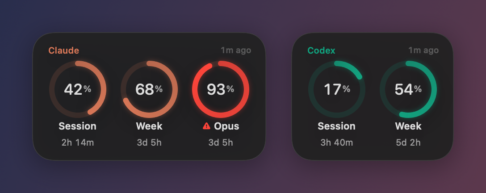

# Headroom

<p align="center"></p>

A small floating macOS and Windows widget that shows how much of your **Claude Code** and **Codex** plan limits you've used — session and weekly — as rings. Refreshes every 5 minutes and turns red past 90%.


> **Unofficial.** Not affiliated with Anthropic or OpenAI. It reads the same usage endpoints the official tools use, which aren't public APIs — they can change at any time and break this.

## Install on Mac (30 seconds)

**1. Open Terminal.** Press <kbd>⌘ Command</kbd> + <kbd>Space</kbd>, type **Terminal**, press <kbd>Return</kbd>.


**2. Paste this and press <kbd>Return</kbd>:**

```sh
curl -fsSL https://raw.githubusercontent.com/calebchin1/headroom/main/install.sh | sh
```


**3. Done.** The widget appears in the top-right of your screen and starts automatically when you log in. You can close Terminal.

The script ([read it here](install.sh)) downloads the latest release, and the app moves itself into `~/Applications`. No password, no security prompts.

### Using it

- **Click** the widget to switch between Claude and Codex
- **⌘ + Caps Lock**, or a click on the menu-bar icon, hides/shows the widget (Mac)
- **Drag** to move it anywhere
- **Right-click** for Refresh, Opacity, Glass (Clear · Glass · Frosted), the usage page, and Quit

### Uninstall

Right-click the widget → **Uninstall Headroom…**

<details>
<summary>Install without Terminal</summary>

[Download Headroom.zip](https://github.com/calebchin1/headroom/releases/latest/download/Headroom.zip), unzip, and double-click **Headroom.app**. macOS will block it the first time because the app isn't notarized: go to **System Settings → Privacy &amp; Security**, scroll down, click **Open Anyway**, and confirm.
</details>

## Install on Windows

1. [Download Headroom.exe](https://github.com/calebchin1/headroom/releases/latest/download/Headroom.exe) and put it wherever you like to keep apps.
2. Double-click it. Windows will show "Windows protected your PC" the first time because the app isn't code-signed: click **More info → Run anyway**.

The widget appears in the top-right and starts when you log in (turn that off with right-click → **Start at Login**). No installer and no admin rights. The `.exe` is built by GitHub Actions straight from [the source](windows/Headroom.cs) for each release, so you can check exactly what it runs.

Click, drag and right-click work the same as on Mac. The Windows version doesn't have the Opacity or Glass menus yet. To uninstall, right-click → **Uninstall Headroom…**, then delete `Headroom.exe`.

## Requirements

- macOS 13+ (Apple Silicon or Intel), or Windows 10/11
- **Claude Code** logged in with a Claude.ai Pro/Max plan, and/or **Codex** logged in with ChatGPT
- API-key logins have no plan limits, so there's nothing to show

## Security & privacy

Headroom is small and has nothing hidden. Everything it does is in [Headroom.swift](Headroom.swift) (Mac) and [windows/Headroom.cs](windows/Headroom.cs) (Windows).

**What it reads**
- The login token Claude Code already saved on your computer: the `Claude Code-credentials` Keychain item on Mac (macOS asks once before allowing it), or `%USERPROFILE%\.claude\.credentials.json` on Windows.
- The login token Codex already saved, in `~/.codex/auth.json`.

It never asks for your password and never stores its own copy of a token.

**Where it connects**
- `api.anthropic.com`, to fetch your Claude usage.
- `chatgpt.com`, to fetch your Codex usage.

That's it. Each token only goes, over HTTPS, to the company that issued it. There are no analytics, no update checks and no servers of ours.

**What it changes on your computer**
- **Mac:** copies itself to `~/Applications/Headroom.app`, adds a login item at `~/Library/LaunchAgents/local.usagerings.plist`, and saves widget position and settings in its preferences.
- **Windows:** adds a `Headroom` startup entry under `HKCU\...\CurrentVersion\Run` (unless you turn off Start at Login), and saves settings under `HKCU\Software\Headroom`.

**Uninstall** (right-click → Uninstall Headroom…) removes all of the above. On Windows, delete `Headroom.exe` afterwards.

## Build from source

Needs the Xcode Command Line Tools (`xcode-select --install`).

```sh
./build.sh        # build universal app and launch it (it installs itself)
./build.sh dist   # build dist/Headroom.zip for sharing
```

On Windows, `.\windows\build.ps1` builds `Headroom.exe` with the C# compiler that comes with Windows.

## License

MIT
