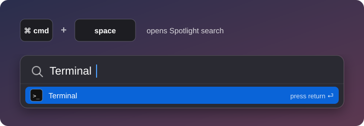

# Headroom

<p align="center"></p>

A small floating macOS and Windows widget that shows how much of your **Claude Code** and **Codex** plan limits you've used — session and weekly — as rings. Refreshes every 5 minutes and turns red past 90%. On Mac, a second panel shows **memory and CPU** live, updated twice a second.


> **Unofficial.** Not affiliated with Anthropic or OpenAI. It reads the same usage endpoints the official tools use, which aren't public APIs — they can change at any time and break this.

## Install on Mac (30 seconds)

**1. Open Terminal.** Press <kbd>⌘ Command</kbd> + <kbd>Space</kbd>, type **Terminal**, press <kbd>Return</kbd>.



**2. Paste this and press <kbd>Return</kbd>:**

```sh
curl -fsSL https://raw.githubusercontent.com/calebchin1/headroom/main/install.sh | sh
```


**3. Done.** The widget appears in the top-right of your screen and starts automatically when you log in. You can close Terminal.

The script ([read it here](install.sh)) downloads the latest release, and the app moves itself into `~/Applications`. No password, no security prompts.

### Using it

- **Click** the widget to switch between Claude and Codex
- The **System** panel (memory + CPU, with a graph of the past 10 minutes) floats separately; drag it anywhere
- **⌘ + Caps Lock**, or a click on the menu-bar icon, hides/shows the widgets; right-click the icon (or a widget) to choose which ones appear
- **Drag** to move it anywhere
- **Right-click** for Refresh, Opacity, Glass (Clear · Glass · Frosted), the usage page, and Quit

### Uninstall

Right-click the widget → **Uninstall Headroom…**

<details>
<summary>Install without Terminal</summary>

[Download Headroom.zip](https://github.com/calebchin1/headroom/releases/latest/download/Headroom.zip), unzip, and double-click **Headroom.app**. macOS will block it the first time because the app isn't notarized: go to **System Settings → Privacy &amp; Security**, scroll down, click **Open Anyway**, and confirm.
</details>

## Install on Windows

Press <kbd>Win</kbd>, type **PowerShell**, press <kbd>Enter</kbd>, then paste this and press <kbd>Enter</kbd>:

```powershell
irm https://raw.githubusercontent.com/calebchin1/headroom/main/install.ps1 | iex
```

The widget appears in the top-right and starts automatically when you log in. The script ([read it here](install.ps1)) downloads [the source](windows/Headroom.cs) and builds it with the C# compiler that comes with Windows, so there's no `.exe` download and no SmartScreen prompt. It installs to `%LOCALAPPDATA%\Headroom`. No admin needed.

Click, drag and right-click work the same as on Mac. The Windows version doesn't have the Opacity or Glass menus yet. To uninstall, right-click → **Uninstall Headroom…**

## Requirements

- macOS 13+ (Apple Silicon or Intel), or Windows 10/11
- **Claude Code** logged in with a Claude.ai Pro/Max plan, and/or **Codex** logged in with ChatGPT
- API-key logins have no plan limits, so there's nothing to show

## Privacy

Your login never leaves your computer except to go to Anthropic or OpenAI. The app reuses the token Claude Code stores in your Keychain (`Claude Code-credentials`, or `%USERPROFILE%\.claude\.credentials.json` on Windows) and the one Codex stores in `~/.codex/auth.json`, sends it over HTTPS to that provider's usage endpoint, and nothing else. No analytics, no other servers. macOS may ask once to allow Keychain access.

## Build from source

Needs the Xcode Command Line Tools (`xcode-select --install`).

```sh
./build.sh        # build universal app and launch it (it installs itself)
./build.sh dist   # build dist/Headroom.zip for sharing
```

## License

MIT
