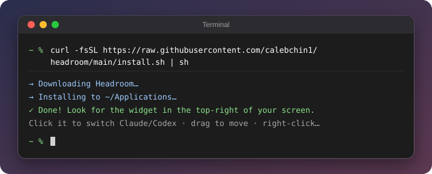

# UsageRings

<p align="center"></p>

A small floating macOS widget that shows how much of your **Claude Code** and **Codex** plan limits you've used — session and weekly — as rings. Refreshes every 5 minutes and turns red past 90%.


> **Unofficial.** Not affiliated with Anthropic or OpenAI. It reads the same usage endpoints the official tools use, which aren't public APIs — they can change at any time and break this.

## Install (30 seconds)

**1. Open Terminal.** Press <kbd>⌘ Command</kbd> + <kbd>Space</kbd>, type **Terminal**, press <kbd>Return</kbd>.


**2. Paste this and press <kbd>Return</kbd>:**

```sh
curl -fsSL https://raw.githubusercontent.com/calebchin1/usage-rings/main/install.sh | sh
```



**3. Done.** The widget appears in the top-right of your screen and starts automatically when you log in. You can close Terminal.

The script ([read it here](install.sh)) downloads the latest release, and the app moves itself into `~/Applications`. No password, no security prompts.

### Using it

- **Click** the widget to switch between Claude and Codex
- **Drag** to move it anywhere
- **Right-click** for Refresh, Opacity, the usage page, and Quit

### Uninstall

Right-click the widget → **Uninstall UsageRings…**

<details>
<summary>Install without Terminal</summary>

[Download UsageRings.zip](https://github.com/calebchin1/usage-rings/releases/latest/download/UsageRings.zip), unzip, and double-click **UsageRings.app**. macOS will block it the first time because the app isn't notarized: go to **System Settings → Privacy &amp; Security**, scroll down, click **Open Anyway**, and confirm.
</details>

## Requirements

- macOS 13+ (Apple Silicon or Intel)
- **Claude Code** logged in with a Claude.ai Pro/Max plan, and/or **Codex** logged in with ChatGPT
- API-key logins have no plan limits, so there's nothing to show

## Privacy

Your login never leaves your Mac except to go to Anthropic or OpenAI. The app reuses the token Claude Code stores in your Keychain (`Claude Code-credentials`) and the one Codex stores in `~/.codex/auth.json`, sends it over HTTPS to that provider's usage endpoint, and nothing else. No analytics, no other servers. macOS may ask once to allow Keychain access.

## Build from source

Needs the Xcode Command Line Tools (`xcode-select --install`).

```sh
./build.sh        # build universal app and launch it (it installs itself)
./build.sh dist   # build dist/UsageRings.zip for sharing
```

## License

MIT
